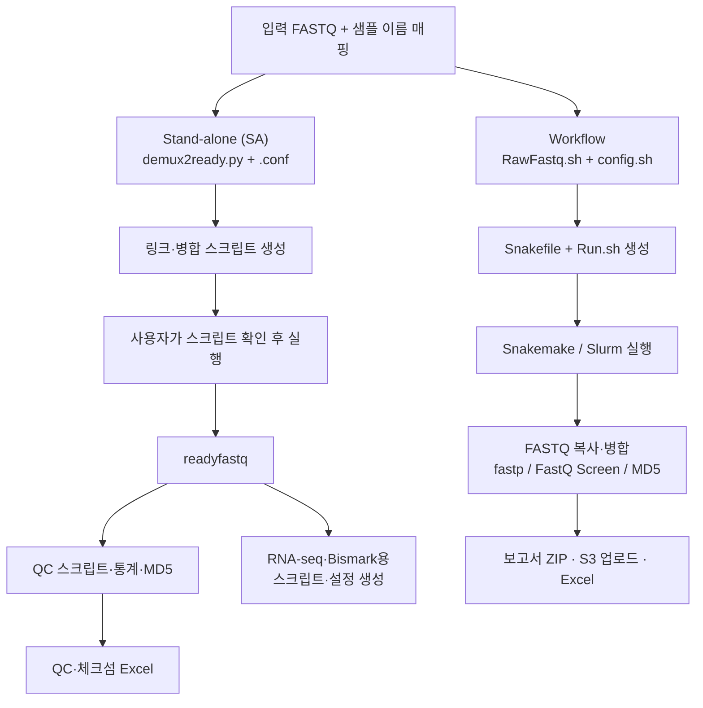

# demux2ready

작성일: 2026-10-16 · 작성자: 유승일

> **Demultiplexing 이후의 FASTQ를 분석과 납품에 사용할 수 있도록 정리하는 도구 모음입니다.**

FASTQ 파일을 찾아 샘플 이름을 변환하고, 여러 레인의 파일을 병합하며, 품질 통계와 체크섬을 정리합니다. RNA-seq·메틸화 분석용 스크립트와 설정 생성, Snakemake 기반 QC 및 납품 워크플로도 제공합니다. 입력은 이미 생성된 FASTQ이며, BCL에서 FASTQ를 만드는 demultiplexing은 이 저장소의 처리 범위에 포함되지 않습니다.

## 처리 흐름

두 실행 경로는 FASTQ를 정리한다는 목적을 공유하지만, 설정 형식과 실행 방식이 다릅니다.

| 구분 | [Stand-alone (SA) 방식](#sa) | [Workflow 방식](#workflow) |
| --- | --- | --- |
| 실행 방식 | Python CLI로 단계별 스크립트를 생성하고 직접 실행 | Snakefile을 생성하고 Snakemake로 실행 |
| 설정 파일 | `demux2ready.conf` | `config.sh` |
| 작업 실행 | Bash 또는 선택적으로 SA 병렬 실행 도구 | Snakemake + Slurm |
| FASTQ 준비 | 단일 파일은 링크, 여러 파일은 병합 | 단일 파일은 복사, 여러 파일은 병합 |
| 기본 활용 | 필요한 QC·분석 단계를 개별 실행 | FASTQ 정리부터 QC·납품까지 연결 |



## 주요 구성

| 경로 | 역할 |
| --- | --- |
| [`demux2ready.py`](demux2ready.py) | FASTQ 검색·이름 변환, 병합·QC·분석용 스크립트 및 설정 생성 |
| [`etc/demux2ready.conf`](etc/demux2ready.conf) | Python CLI용 설정 예시 |
| [`workflow/RawFastq.sh`](workflow/RawFastq.sh) | QC부터 보고서·업로드까지 실행하는 Snakefile 생성 |
| [`workflow/RawFastq_no_Report.sh`](workflow/RawFastq_no_Report.sh) | 보고서·업로드 단계를 제외한 QC 워크플로 생성 |
| [`workflow/make_config.sh`](workflow/make_config.sh) | 서버의 프로젝트·매핑 파일에서 `config.sh` 초안 생성 |
| [`lib/create_excel_report.py`](lib/create_excel_report.py) | fastp 요약, MD5, S3 업로드 결과로 Excel 작성 |
| [`lib/parser.py`](lib/parser.py) | fastp·TopHat·Cufflinks·Cuffnorm·Cuffdiff 결과 요약 |
| [`lib/bismark.py`](lib/bismark.py), [`lib/metilene.py`](lib/metilene.py) | 메틸화 결과 전처리 및 DMR 분석 보조 |
| [`opt/parallelComputing.py`](opt/parallelComputing.py) | 명령 병렬 실행과 작업별 로그 관리 |
| `src/`, `workflow/legacy/` | 참조 BED 파일, 이전 워크플로 |
| [`tests/`](tests/) | Excel 보고서 관련 테스트 |

## 공통 환경 준비

Python 3와 Bash를 사용합니다. 저장소 전체 기능을 설치하는 단일 환경 정의는 없으므로 아래 Python 환경을 준비한 뒤, 선택한 사용법 파트에서 필요한 외부 도구를 확인합니다.

```bash
cd /absolute/path/to/demux2ready
python3 -m venv .venv
source .venv/bin/activate
python -m pip install -r requirements.txt PyYAML
```

`PyYAML`은 메인 CLI가 import하지만 현재 `requirements.txt`에 포함되어 있지 않아 별도로 설치합니다.

<a id="sa"></a>

## Part 1. Stand-alone (SA) 사용법

SA 방식은 `demux2ready.py`로 필요한 단계의 스크립트를 만들고 직접 실행하는 방법입니다. Snakemake나 Slurm 없이 사용할 수 있으며, 작업 순서는 사용자가 관리합니다. 아래 예시는 paired-end FASTQ 기준입니다.

### 1. SA 실행 환경 준비

공통 Python 환경을 활성화하고 실행할 단계에 맞는 도구를 준비합니다.

| 사용할 기능 | 추가 준비 사항 |
| --- | --- |
| FASTQ 링크·병합 | `ln`, `cat`, Bash |
| QC 및 체크섬 | `fastp`, GNU `md5sum`; FastQ Screen 사용 시 `fastq_screen`과 참조 설정 |
| RNA-seq 분석 스크립트 실행 | 선택한 모드에 따라 TopHat·Cufflinks 계열 도구와 참조 파일 |
| 메틸화 분석 | 단계에 따라 Bismark·Bowtie2·Samtools·Picard·Qualimap·Metilene·BEDTools 등 |
| 추가 Python 분석 유틸리티 | 파일에 따라 `biopython`, `numpy`, `scipy`, `statsmodels` 등 |

### 2. 작업 디렉터리와 설정 만들기

아래 경로는 실제 저장소·프로젝트·입력 FASTQ 위치로 바꿉니다. 입력 경로는 절대 경로를 사용하는 것이 좋습니다.

```bash
REPO=/absolute/path/to/demux2ready
mkdir -p /data/projects/demo-fastq
cd /data/projects/demo-fastq

cat > demux2ready.conf <<'EOF'
DEMUXPATH /data/raw/run01
DEMUXPATH /data/raw/run02
IDMAP SampleA Patient01
IDMAP SampleB Patient02
META CPU 8
EOF
```

| 설정 | 의미 | 예시 |
| --- | --- | --- |
| `DEMUXPATH` | 입력 FASTQ를 재귀 검색할 디렉터리. 여러 줄 지정 가능 | `DEMUXPATH /data/raw/run01` |
| `IDMAP` | 입력 샘플 ID → 출력 샘플 ID | `IDMAP SampleA Patient01` |
| `META` | CPU 수, 참조 유전체·주석 등 도구별 옵션 | `META CPU 8` |
| `COMP` | 비교 ID, 대조군 이름·샘플 목록, 실험군 이름·샘플 목록 | `COMP DEG001 control Patient01,Patient02 case Patient03,Patient04` |
| `BASEADJUST` | 기본 10분할 결과 중 앞에서부터 사용할 조각 수 | `BASEADJUST Patient01 5` |

단순 FASTQ 정리와 QC에는 위의 최소 설정으로 시작할 수 있습니다. `COMP`·`BASEADJUST`와 참조 파일 `META`는 해당 분석 모드를 사용할 때 추가합니다. 서로 다른 입력 ID를 동일한 출력 ID로 매핑하면 해당 입력들을 함께 병합하는 스크립트를 생성합니다.

### 3. FASTQ 정리 스크립트 생성·확인·실행

```bash
python "$REPO/demux2ready.py" \
  --conf-fn demux2ready.conf \
  --work-dir demux2ready \
  --find-fastq-mode demux \
  --mode mksh_d2r

cat demux2ready/demux2ready.sh
# 입력 파일 경로와 R1/R2 구성이 올바른지 확인한 뒤 실행
bash demux2ready/demux2ready.sh
```

`mksh_d2r`는 스크립트를 생성합니다. 실행하면 각 read에 대해 입력이 하나일 때 심볼릭 링크를 만들고, 여러 개일 때 정렬된 파일 목록을 `cat`으로 병합합니다.

| 검색 모드 | 입력 파일명 예시 |
| --- | --- |
| `demux` | `SampleA_S1_L001_R1_001.fastq.gz`, `SampleA_S1_R1_001.fastq.gz` 및 대응 R2 |
| `outsourcing` | `SampleA_R1.fastq.gz`, `SampleA_R1.fq.gz`, `SampleA_1.fastq.gz`, `SampleA_1.fq.gz` 및 대응 R2 |

외주 FASTQ에는 `--find-fastq-mode outsourcing`을 사용합니다. 출력은 `demux2ready/readyfastq/Patient01_R1.fastq.gz`, `Patient01_R2.fastq.gz` 형식입니다. 메인 CLI의 기본 스크립트 생성은 paired-end 구성을 전제로 합니다.

### 4. fastp QC와 MD5 생성

```bash
# fastp 실행 스크립트 생성 및 실행
python "$REPO/demux2ready.py" \
  --conf-fn demux2ready.conf --work-dir demux2ready --mode mksh_fastp
bash demux2ready/fastp.sh

# fastp JSON을 샘플별 TSV로 요약
python "$REPO/demux2ready.py" \
  --conf-fn demux2ready.conf --work-dir demux2ready --mode parse_fastp

# readyfastq의 FASTQ 체크섬 생성
python "$REPO/demux2ready.py" \
  --conf-fn demux2ready.conf --work-dir demux2ready --mode md5sum
```

`mksh_fastp`는 QC용 JSON·HTML을 생성하는 명령을 작성하며, 정제 FASTQ 출력은 지정하지 않습니다. 정제 FASTQ가 필요하면 `mksh_fastp_clean` 모드로 별도의 스크립트를 생성합니다.

### 5. QC·체크섬 Excel 생성 및 결과 확인

```bash
python "$REPO/lib/create_excel_report.py" \
  --fastp demux2ready/fastp.summary.tsv \
  --md5sum demux2ready/md5sum.summary.tsv \
  --output demo-fastq-info.xlsx
```

기본 S3 결과 파일인 `atgcu-util.s3-upload.result.tsv`가 없으면 QC와 MD5를 포함한 Excel을 생성합니다. 해당 파일이 있으면 다운로드 정보도 함께 사용하며, 다른 경로의 결과는 `--s3upload`로 지정할 수 있습니다. 사용할 보고서 유형은 입력 파일의 존재 여부로 결정됩니다.

| 결과 파일 | 내용 |
| --- | --- |
| `demux2ready/readyfastq/*_R[12].fastq.gz` | 출력 샘플 ID로 정리된 FASTQ |
| `demux2ready/readyfastq/*.fastp.json`, `*.fastp.html` | 샘플별 fastp 결과 |
| `demux2ready/fastp.summary.tsv` | read·base 수, GC·Q20·Q30 비율, 중복률 등 |
| `demux2ready/md5sum.summary.tsv` | FASTQ 체크섬과 경로. 헤더 없는 2열 형식 |
| `demo-fastq-info.xlsx` | Sequencing Info 및 Download Info 시트 |

### 6. SA 추가 모드

전체 옵션은 `python "$REPO/demux2ready.py" --help`로 확인합니다.

| 목적 | 모드 |
| --- | --- |
| FastQ Screen 명령 생성 | `mksh_fastq_screen` |
| 정제·길이 조절 명령 생성 | `mksh_fastp_clean`, `mksh_cutadapt` |
| FASTQ 분할 및 일부 조각 병합 명령 생성 | `mksh_fastp_split` |
| nf-core 입력 파일 생성 | `mkconf_nfcore_rnaseq`, `mkconf_nfcore_differentialabundance` |
| 자체 RNA-seq 입력 파일 생성 | `mkconf_atgcu_rnaseq`, `samplefile` |
| TopHat·Cufflinks 계열 명령 생성 | `mksh_tophat`, `mksh_cuffquant`, `mksh_cufflinks`, `mksh_cuffnorm`, `mksh_cuffdiff` |
| Bismark 및 후처리 명령 생성 | `mksh_bismark` |

분석 모드에는 해당 참조 파일과 도구가 필요합니다. 생성되는 설정 중 differentialabundance의 condition·replicate·contrast 등은 예시 값이므로 실제 실험 설계에 맞게 수정합니다. `mksh_cutadapt`는 현재 말단 119 bp 절단 옵션이 고정되어 있으므로 입력 read 길이와 목적을 먼저 확인합니다.

### 7. 선택 사항: SA 병렬 실행

생성된 스크립트는 `bash`로 순서대로 실행할 수 있습니다. 같은 단계의 독립적인 샘플 작업을 동시에 실행하려면 `opt/parallelComputing.py`의 `SA` 엔진을 사용할 수 있습니다. 아래 예시는 앞의 `bash demux2ready/fastp.sh`를 대신하는 실행 방법입니다.

```bash
{
  printf '#fork\n'
  cat demux2ready/fastp.sh
  printf '#join\n'
} | python "$REPO/opt/parallelComputing.py" -t 2 SA
```

`#fork`와 `#join` 사이의 명령을 최대 2개씩 동시에 실행하며, 작업 로그는 현재 디렉터리의 `task_logs/`에 저장합니다. 설정의 `META CPU 8`은 fastp 명령당 스레드 수이므로 동시에 2개를 실행하면 최대 16개 스레드를 요청합니다. FASTQ 준비와 QC처럼 선후 관계가 있는 단계는 완료를 확인한 뒤 다음 단계로 진행합니다.

### SA 사용 시 확인할 점

- **입력 파일 확인:** `mksh_d2r`는 파일을 찾지 못해도 `cat > 출력파일` 명령을 생성합니다. 실행 전에 스크립트에서 R1/R2 입력 경로와 샘플 대응을 확인합니다.
- **직접 준비 모드:** `prepare`는 단일 입력의 링크만 만들며, 복수 파일 병합은 미구현입니다. 여러 레인에는 `mksh_d2r`를 사용합니다.
- **재실행:** Python CLI가 생성한 링크·병합 스크립트에는 기존 출력의 재사용·덮어쓰기 정책이 통일되어 있지 않습니다. 별도의 작업 디렉터리로 시작하면 결과를 구분하기 쉽습니다.

<a id="workflow"></a>

## Part 2. Workflow 사용법

Workflow 방식은 `RawFastq.sh`로 Snakefile을 만들고 Snakemake/Slurm으로 작업을 실행합니다. 별도의 `config.sh`를 사용하며, FASTQ 준비·QC·보고서 생성의 실행 순서는 Snakemake가 관리합니다. 현재 `/home/rawfastq/demux2ready`, `/bc_storage/BioSeqData/Outsourcing/`와 외부 보고서·업로드 도구의 경로가 코드에 고정되어 있습니다. 다른 서버에서는 관련 경로와 도구 설정을 먼저 맞춰야 합니다.

### 1. Workflow 실행 환경 준비

공통 Python 환경과 함께 아래 도구 및 서버 설정을 준비합니다.

| 구분 | 준비 사항 |
| --- | --- |
| 셸·기본 도구 | Bash 4 이상, Linux의 `cp`, `cat`, `xargs`, GNU `md5sum`, `jq` |
| 작업 관리 | `snakemake`, `snakemake-executor-plugin-cluster-generic`, Slurm의 `sbatch`와 제출 환경 |
| QC | `fastp`, `fastq_screen` 및 참조 설정 |
| 전체 납품 단계 | 외부 `atgcu-report`, `atgcu-util` 저장소와 업로드 권한, `zip` |

### 2. 프로젝트 설정 만들기

```bash
mkdir -p /data/projects/DEMO001
cd /data/projects/DEMO001
```

프로젝트 디렉터리에 다음 내용으로 `config.sh`를 저장합니다.

```bash
PR="DEMO001"
path="/data/raw/DEMO001"
Oname="SampleA SampleB"
Rname="Patient01 Patient02"
Counts="2"
SeqType="paired-end"
Mode="ngs-only"
Name="Customer"
Affiliation="Institute"
Date="261016"
```

- `Oname`은 입력 파일에서 검색할 이름, `Rname`은 출력 샘플 이름입니다. 개수와 순서를 맞춥니다.
- `SeqType`은 `paired-end` 또는 `single-end`입니다. paired-end 설정에서는 모든 샘플의 R2가 필요합니다.
- `Mode`는 `ngs-only`, `mb-consortium`, `dtc-microbiome` 중 하나입니다. `mb-consortium`을 제외하면 `Name`과 `Affiliation`이 필수입니다.
- 입력 이름은 `SampleA_R1.fastq.gz`, `SampleA_1.fq.gz`와 같이 read 번호로 끝나는 형식을 검색합니다. Python CLI의 demux 파일명 검색 규칙과 다릅니다.

`config.sh`가 없으면 `make_config.sh`로 초안을 생성한 뒤 종료합니다. 자동 생성은 현재 디렉터리 이름으로 서버의 프로젝트 경로를 찾고, `*map` 파일의 첫 번째 열을 출력 이름, 두 번째 열을 입력 이름으로 읽습니다. 매핑 파일은 헤더 없는 형식으로 준비하고 생성 결과를 확인합니다.

### 3. Workflow 생성 및 실행 계획 확인

전체 납품 과정은 `RawFastq.sh`를 사용합니다. QC까지만 필요하면 아래 명령에서 `RawFastq_no_Report.sh`로 바꿔 실행합니다. 두 스크립트는 같은 이름의 `Snakefile`과 `Run.sh`를 생성하므로 사용할 경로 하나를 선택합니다.

```bash
# Snakefile과 Run.sh 생성
bash /home/rawfastq/demux2ready/workflow/RawFastq.sh

# 작업 계획 확인
snakemake -n
```

### 4. Slurm으로 작업 제출

```bash
bash Run.sh
```

### 5. 결과 확인

전체 워크플로의 마지막 단계는 외부 보고서 생성, ZIP 압축, S3 업로드, 다운로드 정보 Excel 생성을 실행합니다. 작업 로그는 `logs/`에 기록됩니다.

| 결과 | 기본 경로·파일명 |
| --- | --- |
| 정리된 FASTQ | `demux2ready/readyfastq/*_R[12].fastq.gz` |
| fastp 요약 및 MD5 | `demux2ready/fastp.summary.tsv`, `demux2ready/md5sum.summary.tsv` |
| FastQ Screen 결과 | `demux2ready/fastq_screen/` |
| QC 보고서 ZIP | `<PR>-RawFastq-QC-Report-v<Date>.zip` |
| 다운로드 정보 Excel | `<PR>-RawFastq-Download-Info-v<Date>.xlsx` |
| Slurm 작업 로그 | `logs/<rule>.out`, `logs/<rule>.err` |

보고서 ZIP과 다운로드 정보 Excel은 전체 워크플로에서 생성합니다. `RawFastq_no_Report.sh`에서는 FASTQ·QC·MD5 결과까지만 생성합니다.

### Workflow 사용 시 확인할 점

- **서버의 샘플 검색:** 부분 문자열 매칭을 사용하므로 `sample1`이 `sample10` 파일도 선택할 수 있습니다. 입력 이름의 중복 포함 관계를 확인해야 합니다.
- **보고서와 체크섬:** 서버 `report` 규칙에는 MD5 결과에 대한 의존성이 빠져 있어 완료 순서가 보장되지 않습니다. 최종 Excel의 MD5 포함 여부를 확인합니다.
- **업로드 단계:** `snakemake_final.sh`에는 같은 업로드 명령이 연속 두 번 있습니다. 중복 호출의 실제 처리 방식은 외부 업로드 도구 구현에 따라 달라집니다.

